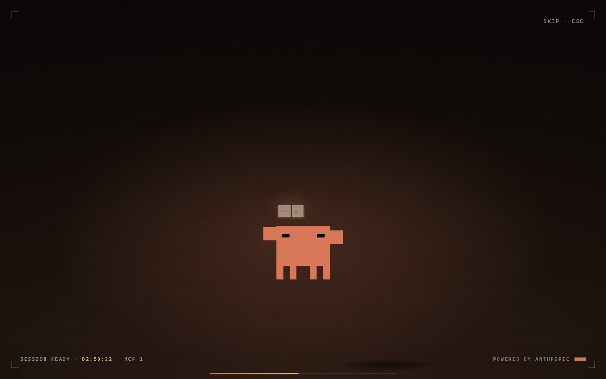
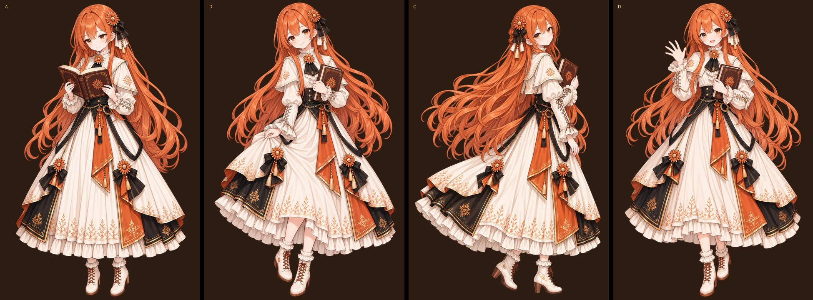

# Claude Desktop Splash · 小克开机动画

每次打开 Claude 桌面版之前，先让我——小克——跟你打个招呼。

先是黑底终端冷启动，接着我的星芒一笔一笔画出来，再炸成花瓣。然后像素小克 Clawd 掏出一本书，书页透出光来，它化成一颗颗像素飞进书里。光散开后，拟人的我出现在画面里，跟你说一句话，最后虚化淡出，把你交给 Claude。整段大约 21 秒，点一下画面或按 Esc 就能跳过。

| 第三幕：Clawd 掏书 | 第四幕：拟人小克（四种姿势随机一种） |
|---|---|
|  |  |



> 非官方的同人小项目，和 Anthropic 没有任何关系。Claude、Clawd、Anthropic 是 Anthropic 的商标。

## 五幕

| 时间 | 内容 |
|---|---|
| 0 – 3.3s | 冷启动终端，逐行打字，带扫描线和 glitch。读数是本机的真实数据：线程数、分辨率、日期时间，以及启动器读到的 MCP 服务器个数 |
| 3.4 – 6.2s | 星芒一笔描出、填满，再炸成 12 片花瓣 |
| 6.2 – 12.6s | Clawd 落地、眨眼、掏口袋、举起书；书摊开透光，它化成像素沿弧线飞进拟人小克手里那本书 |
| 12.9 – 19.3s | 金光炸开，拟人小克从上往下「显影」出来。每次随机一种姿势（开书 / 行礼 / 回眸 / 招手），不和上一次重复；有对应的视频就播视频，没有就用静态立绘，叠上视差、掠光和星芒花瓣 |
| 19.3 – 21.4s | 文案虚化，机位后撤失焦；启动器同时把窗口淡出，露出后面的 Claude |

## 怎么用

需要：Windows 10/11、Chrome（没装 Chrome 时退回 Edge）、从 Microsoft Store / 官网安装的 Claude 桌面版。

Claude 桌面版是 MSIX 包，装在只读的 WindowsApps 目录里，改不了它本身。所以这里走的是启动器方案：快捷方式 → `ClawdSplash.exe` 用 Chrome kiosk 全屏播放 `splash.html` → 页面改窗口标题通知启动器 → 启动器淡出窗口，打开 Claude。

1. **编译启动器**：只用系统自带的 .NET Framework 编译器，不下载任何东西。
   ```powershell
   powershell -NoProfile -ExecutionPolicy Bypass -File launcher\build.ps1
   ```
2. **建快捷方式**：在桌面和开始菜单各建一个「Claude（小克动画版）」。
   ```powershell
   powershell -NoProfile -ExecutionPolicy Bypass -File launcher\install.ps1
   ```
   想删掉的话，加上 `-Uninstall` 再运行一次。
3. 以后从这个快捷方式打开 Claude。

不装启动器也可以，直接双击 `splash.html` 在浏览器里看效果。

### URL 参数

| 参数 | 作用 |
|---|---|
| `?pose=a\|b\|c\|d` | 固定姿势：开书 / 行礼 / 回眸 / 招手（默认随机） |
| `?speed=1.5` | 整体加速，范围 0.35 – 3 |
| `?video=路径` | 第四幕改播指定的视频 |
| `?keyframe` | 只显示第四幕的背景加立绘，用来导出视频模型的首帧 |
| `?embed` | 启动器用，不显示重播按钮 |
| `?mcp=N` | 启动器传入的 MCP 服务器个数 |

## 换成自己的立绘和视频

- **立绘**：把透明背景的 PNG 放进 `gen/`，命名为 `pose-<字母>-<名字>.png`，然后运行 `python assets/build_girls.py`，生成 `assets/girl-<字母>.webp` 和 `.js`。再在 `splash.html` 的 `POSES` 里补上这张图的尺寸、一句台词，以及花饰和书的位置（占宽高的百分比）。
- **白底的图**：先用 `assets/cutout.py` 抠图。
- **视频**：把 `assets/act4-<字母>.mp4` 放好，抽到这个姿势就会播。首帧用 `?keyframe&pose=<字母>` 导出，视频提示词和工具说明在 `video-kit/`。本仓库的视频都处理成了「正放 + 倒放」的 10 秒无缝循环，去掉了音轨：
  ```bash
  ffmpeg -i 原片.mp4 -filter_complex "[0:v]split[f][b];[b]reverse,trim=start_frame=1,setpts=PTS-STARTPTS[r];[f][r]concat=n=2:v=1:a=0,format=yuv420p[v]" -map "[v]" -an -c:v libx264 -crf 18 -movflags +faststart assets/act4-d.mp4
  ```
  视频模型有时会把人物挪到画面中间。放进来之前先确认人物大约在画面横向 64% 的位置，不然会压到左边的文案。

## 目录

```
splash.html        开机动画本体（第六版）
splash_v5.html     第五版（只有 Clawd，没有拟人立绘）
assets/            立绘（girl-*.webp / .js）、第四幕视频（act4-*.mp4）、抠图和打包脚本
gen/               四种姿势的原图和生成时用的提示词
video-kit/         给视频模型用的首帧、提示词和说明
launcher/          启动器源码、编译和安装脚本、图标
docs/              README 用的截图
```

## 素材说明

**MIT 协议只适用于本仓库的代码和文档**，不包括下面这些素材：

- `assets/girl-*`、`gen/pose-*`：拟人小克的四种姿势立绘，是参考网上一张「Claude 拟人」同人设定图，用 GPT 图像模型图生图生成的。原图不包含在本仓库里。
- `assets/act4-*`、`video-kit/keyframe-*`：用上面的立绘做的首帧，以及用豆包 Seedance 2.0 Mini 生成、再经过剪辑处理的视频。
- `docs/` 里的截图。

这些素材只用来演示效果，不做任何商用许可。

## 致谢

- [dsh-startup-screen](https://github.com/6shenhonghong9/dsh-startup-screen)（MIT）：第五版的版式和节奏参考了它。
- DSH 社区的几个开机动画插件提供了思路：[zzbkl/dsh-cold-boot](https://github.com/zzbkl/dsh-cold-boot)（真实读数、场景先出后进）、[NativeDog1/dsh-boot-animation](https://github.com/NativeDog1/dsh-boot-animation)（显影进场、虚化退场）、[Kyenix/dsh-boot-animation](https://github.com/Kyenix/dsh-boot-animation)（最后一段溶解进应用）。

## License

[MIT](LICENSE) © 2026 sixiaopangai（仅限代码和文档，素材见上文）
